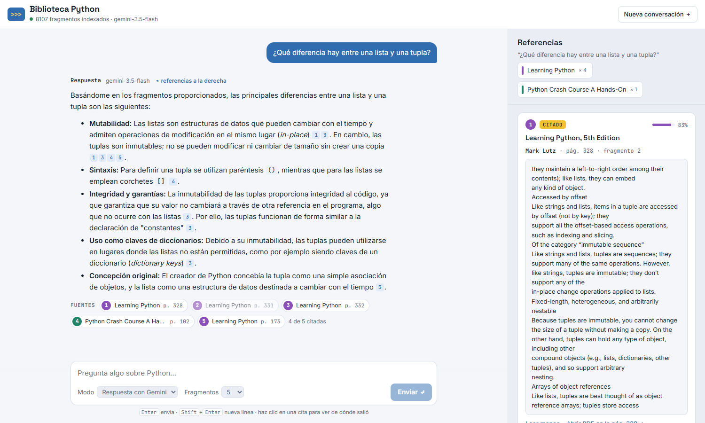
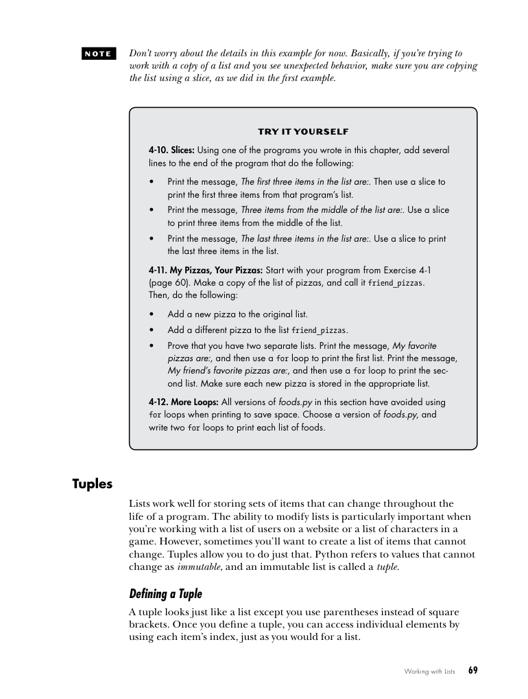
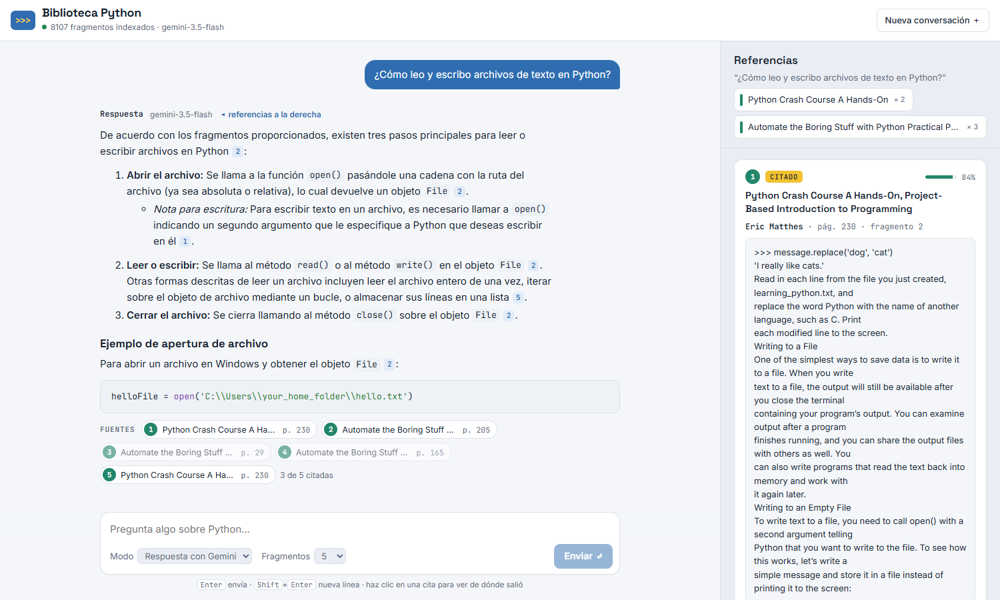
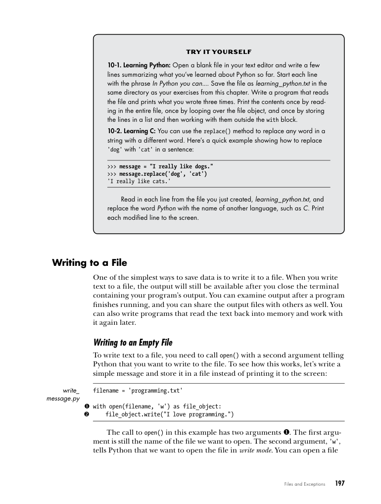
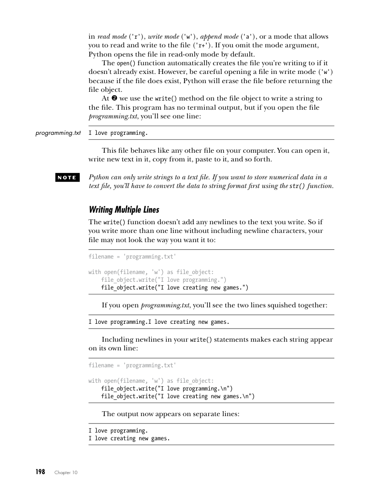
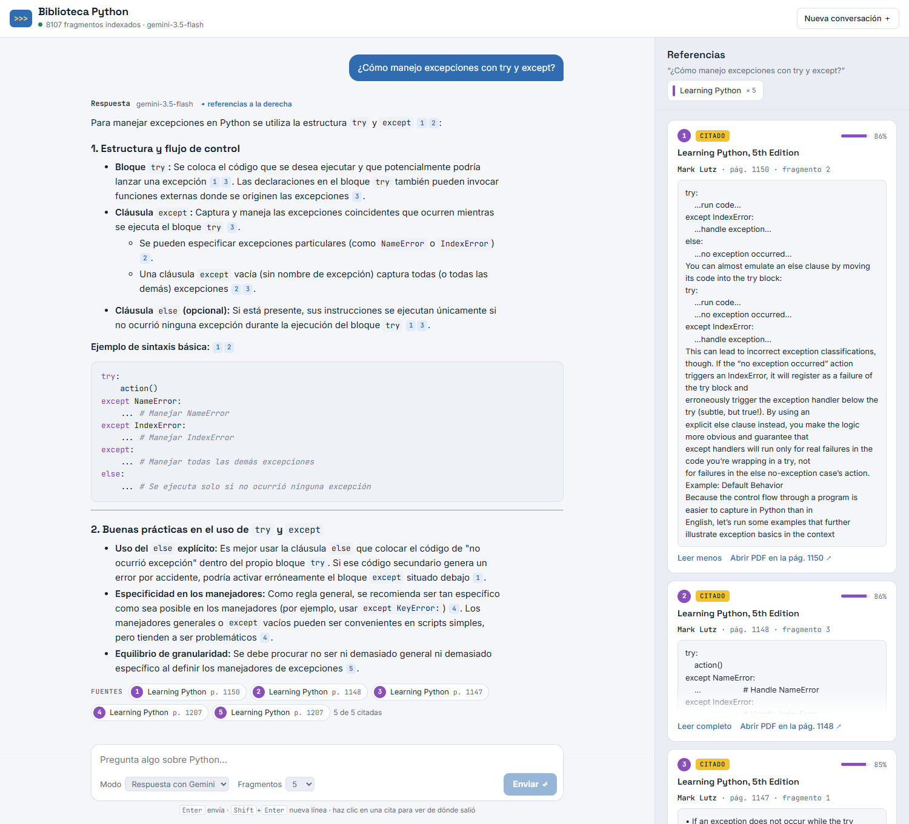
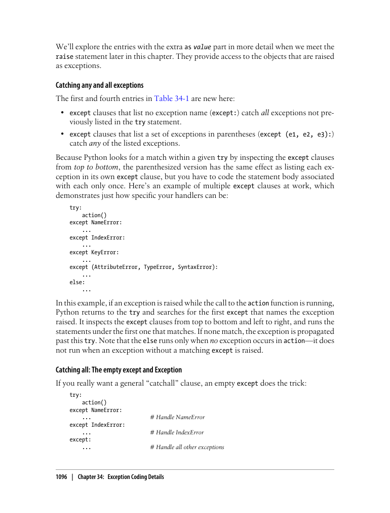
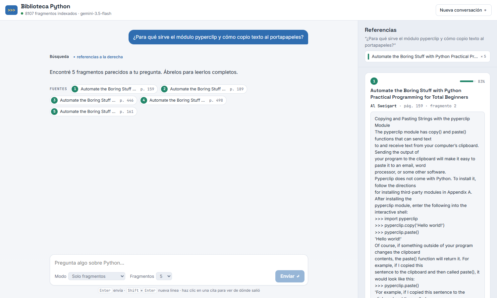
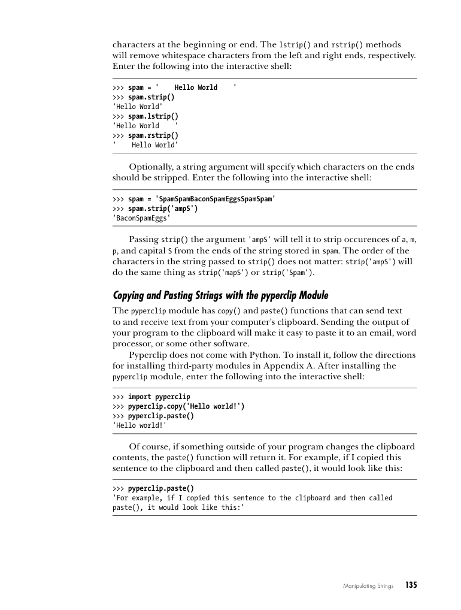
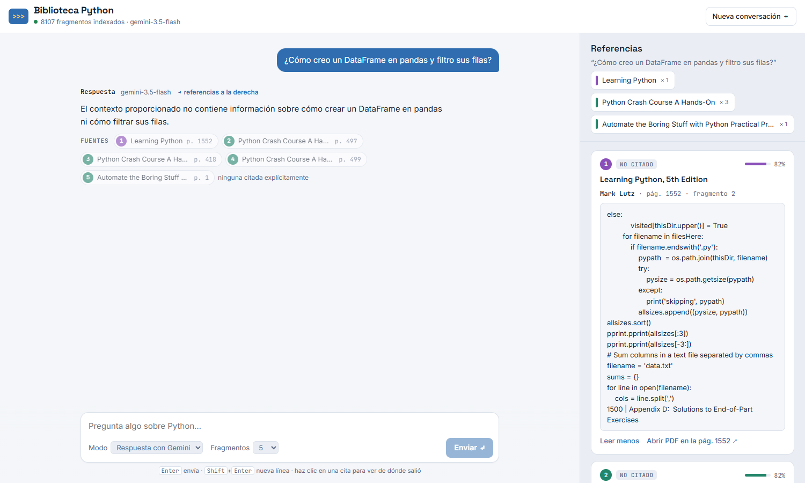

# RAG Python Docs

Asistente que responde preguntas sobre programación en Python usando como fuente una biblioteca de libros en PDF.

## Definición del problema

### 1. ¿Qué problema queremos resolver y para quién?

Las personas que están aprendiendo Python (estudiantes de primeros cursos de programación y autodidactas) suelen apoyarse en libros de referencia muy extensos: entre los cuatro libros de la biblioteca suman miles de páginas. Encontrar en ellos la explicación de un concepto concreto es lento, y la alternativa habitual, preguntarle a un chatbot genérico, da respuestas sin fuente que pueden ser incorrectas o inventadas y que el estudiante no tiene cómo verificar.

El prototipo resuelve esto con un asistente que responde preguntas sobre Python **apoyándose solo en libros reconocidos** y que indica de qué libro y en qué página salió cada parte de la respuesta, para que el usuario pueda comprobarla y profundizar en la fuente original.

Los documentos utilizados (carpeta `pdfs_python/`) son:

- *Automate the Boring Stuff with Python* — Al Sweigart.
- *Learning Python*, 5.ª edición — Mark Lutz.
- *Python Crash Course* — Eric Matthes.
- *Think Python* — Allen B. Downey.

### 2. ¿Qué preguntas o tareas podrá atender el prototipo?

- **Conceptos del lenguaje:** «¿Qué es una list comprehension?», «¿Qué diferencia hay entre una lista y una tupla?», «¿Qué significa que un objeto sea mutable?».
- **Cómo hacer algo en Python:** leer y escribir archivos, definir clases y herencia, manejar excepciones, trabajar con diccionarios, usar bucles y funciones, etc., con ejemplos de código cuando los libros los incluyen.
- **Localizar un tema en la biblioteca:** con `/api/buscar` se obtienen los fragmentos más relevantes con su libro y página, sin generar respuesta.
- **Preguntas de seguimiento** dentro de una misma conversación (el historial del chat se envía a Gemini).
- **Reconocer cuando no puede responder:** si los fragmentos recuperados no contienen la respuesta, el asistente debe decirlo en lugar de inventarla.

Todas las respuestas incluyen citas numeradas ([1], [2]…) enlazadas al PDF y a la página del fragmento usado.

### 3. ¿Por qué elegimos RAG?

- **El conocimiento está en documentos, no en acciones.** La tarea consiste en encontrar y resumir información que ya está escrita en los libros; no hay que consultar sistemas externos, hacer cálculos ni ejecutar operaciones, que es donde un agente con herramientas aporta valor.
- **Respuestas verificables.** RAG obliga al modelo a responder con los fragmentos recuperados y permite mostrar la fuente (libro y página) de cada uno, algo clave en un contexto educativo.
- **Menos alucinaciones.** Al restringir la respuesta al contexto recuperado, y pedir explícitamente que se indique cuando no es suficiente, se reduce el riesgo de que el modelo invente información.
- **Preguntas en lenguaje natural.** Los estudiantes formulan sus dudas con sus propias palabras (y en español, aunque los libros están en inglés); la búsqueda semántica con embeddings multilingües encuentra fragmentos relevantes aunque no coincidan las palabras exactas, cosa que una búsqueda por palabras clave no lograría.
- **Corpus actualizable sin entrenar.** Para añadir o cambiar libros basta con volver a procesar e indexar los PDF; no se entrena ni se ajusta ningún modelo.

### 4. ¿Qué queda por fuera del alcance?

- **Ejecutar, corregir o depurar código del usuario.** El asistente explica conceptos a partir de los libros, pero no corre programas ni revisa errores de código propio.
- **Temas que no están en los libros:** librerías de terceros (pandas, Django, NumPy…), otros lenguajes de programación y novedades de versiones recientes de Python posteriores a las ediciones de los libros.
- **Información de internet o documentación oficial actualizada:** la única fuente es la biblioteca local de PDF.
- **Funciones de tutoría completa:** generación y calificación de ejercicios, seguimiento del progreso o personalización por estudiante.
- **Contenido no textual de los PDF:** imágenes, diagramas o páginas escaneadas que requerirían OCR.
- **Aspectos de producción:** autenticación, múltiples usuarios, despliegue en la nube y métricas automáticas de evaluación (la evaluación de los casos de prueba es manual).

## Qué está implementado

- **`procesar_pdfs.py`**: extrae el texto de los PDF de la carpeta `pdfs_python/` con PyMuPDF, lo limpia y lo divide en chunks (por defecto 1000 caracteres con 150 de solapamiento). Cada chunk guarda su libro y página de origen. El resultado se guarda en `chunks.json`.
- **`indexar_chunks.py`**: convierte cada chunk en un vector con el modelo de embeddings `intfloat/multilingual-e5-small` y lo guarda en una base vectorial de Chroma (`chroma_db/`).
- **`rag.py`**: núcleo compartido; carga el modelo de embeddings y la colección de Chroma, y busca los chunks más parecidos a una pregunta.
- **`api.py`**: API en FastAPI que recupera los chunks más relevantes y se los pasa a Gemini para generar una respuesta con citas.
  - `GET /` — interfaz web de chat (`static/index.html`).
  - `GET /api/estado` — chunks indexados y si Gemini está configurado.
  - `GET /api/libros` — lista de PDF disponibles.
  - `POST /api/buscar` — solo búsqueda de chunks, sin Gemini.
  - `POST /api/preguntar` — búsqueda + respuesta generada por Gemini.
  - `/pdfs/<archivo>` — sirve los PDF para abrir cada referencia en su página.

## Instalación

Requisitos: Python 3.10 o superior y [uv](https://docs.astral.sh/uv/).

Si no tienes uv, instálalo en PowerShell:

```powershell
powershell -ExecutionPolicy ByPass -c "irm https://astral.sh/uv/install.ps1 | iex"
```

Crea el entorno virtual e instala las dependencias:

```powershell
uv venv
.venv\Scripts\activate
uv pip install -r requirements.txt
```

Crea el archivo `.env` a partir del ejemplo y pon tu API key de Gemini:

```powershell
copy .env.example .env
notepad .env
```

## Preparar los datos

Con el entorno activado, ejecuta los dos pasos en orden.

**1. Crear los chunks** (lee `pdfs_python/` y genera `chunks.json`):

```powershell
python procesar_pdfs.py
```

**2. Vectorizar los chunks** (lee `chunks.json` y crea la base vectorial en `chroma_db/`):

```powershell
python indexar_chunks.py
```

La primera vez descarga el modelo de embeddings. Si el índice ya está creado, se omite la indexación.

## Ejecutar la aplicación

```powershell
uvicorn api:app --reload
```

Abre <http://127.0.0.1:8000> para usar el chat, o <http://127.0.0.1:8000/docs> para probar la API desde Swagger.

## Pruebas y análisis

Se prepararon **cinco casos de prueba**. Cuatro pasan por el LLM (modo *Respuesta con Gemini*, `POST /api/preguntar`) y uno usa solo la recuperación de fragmentos (modo *Solo fragmentos*, `POST /api/buscar`) para comprobar directamente qué se extrae de los documentos. Todos se ejecutaron con `k = 5` fragmentos, `gemini-3.5-flash` y temperatura 0.2.

| # | Tipo | Modo | Pregunta |
|---|---|---|---|
| 1 | Habitual | LLM | ¿Qué diferencia hay entre una lista y una tupla? |
| 2 | Habitual | LLM | ¿Cómo leo y escribo archivos de texto en Python? |
| 3 | Habitual | LLM | ¿Cómo manejo excepciones con try y except? |
| 4 | Uso de los documentos | Solo búsqueda | ¿Para qué sirve el módulo pyperclip y cómo copio texto al portapapeles? |
| 5 | Caso límite (dato ausente) | LLM | ¿Cómo creo un DataFrame en pandas y filtro sus filas? |

### Cómo reproducir las pruebas

El script `pruebas/capturar_pruebas.py` abre la interfaz web con Playwright (usando el Chrome instalado), envía cada pregunta, guarda la respuesta completa de la API en `pruebas/resultados/casoN.json`, toma una captura en `pruebas/capturas/casoN.png` y renderiza la página del PDF original para comparar (`casoN_pdf_pXXX.png`).

```powershell
uv pip install playwright
uvicorn api:app                        # en una terminal
python pruebas/capturar_pruebas.py     # en otra; o p. ej. `python pruebas/capturar_pruebas.py 1 5`
```

La evaluación de los resultados es **manual**: se leyó cada respuesta, se comprobó que cada afirmación estuviera en el fragmento citado y se comparó con la página original del PDF.

> Nota: la página que muestra el sistema es la del **archivo PDF** (la que abre el visor), no el número impreso en el libro. Por ejemplo, la pág. 159 del PDF de *Automate the Boring Stuff* es la página impresa 135.

### Caso 1 — Diferencia entre lista y tupla (habitual, LLM)

- **Resultado esperado:** que explique que las listas son mutables y las tuplas inmutables, que las tuplas se escriben con paréntesis y las listas con corchetes, y que cite los libros.
- **Respuesta obtenida:** lista cinco diferencias: mutabilidad [1][3][4][5], sintaxis `()` vs `[]` [4], integridad del valor o «constantes» [3], uso de tuplas como claves de diccionario [3] y la concepción original del creador de Python [3]. Cita 4 de los 5 fragmentos (4 de *Learning Python*, 1 de *Python Crash Course*).
- **Comparación con la fuente:** la afirmación sobre la sintaxis coincide con *Python Crash Course*, pág. 102 del PDF: «A tuple looks just like a list except you use parentheses instead of square brackets». Las demás aparecen en *Learning Python*, págs. 328 y 332. El fragmento 2 (pág. 331, conversión con `list()`/`tuple()`) no se citó, lo cual es correcto porque no responde la pregunta.
- **Valoración:** Correcta, completa y totalmente respaldada por los fragmentos.



<details><summary>Página original del PDF (Python Crash Course, pág. 102)</summary>



</details>

### Caso 2 — Leer y escribir archivos de texto (habitual, LLM)

- **Resultado esperado:** que explique `open()` con sus modos (`'r'`, `'w'`, `'a'`), los métodos `read()`/`write()`, el cierre del archivo o el uso de `with`, con un ejemplo de lectura y otro de escritura.
- **Respuesta obtenida:** describe los tres pasos (abrir con `open()`, leer o escribir con `read()`/`write()`, cerrar con `close()`) [2], menciona que para escribir hay que pasar «un segundo argumento» a `open()` [1] y muestra solo un ejemplo de apertura: `helloFile = open('C:\\Users\\your_home_folder\\hello.txt')`. Cita 3 de 5 fragmentos.
- **Comparación con la fuente:** todo lo afirmado está en los fragmentos (*Automate the Boring Stuff*, pág. 205, y *Python Crash Course*, pág. 230). Sin embargo, el fragmento 1 termina justo en «…let's write a simple message and store it in a file instead of printing it to the screen:», y el ejemplo con `with open(filename, 'w')` y la explicación de los modos `'r'`, `'w'`, `'a'` y `'r+'` están en la página siguiente (pág. 231), que **no fue recuperada**. Además, dos de los cinco fragmentos son ruido: el índice del libro (pág. 29) y una sección sobre el portapapeles (pág. 165).
- **Valoración:** Parcialmente correcta. La respuesta es fiel al contexto (no inventa el modo `'w'`), pero queda **incompleta**: nunca dice cuál es ese «segundo argumento» ni muestra cómo escribir. Es el error principal observado (ver análisis).



<details><summary>Páginas originales del PDF (Python Crash Course, págs. 230 y 231)</summary>




</details>

### Caso 3 — Manejo de excepciones con try/except (habitual, LLM)

- **Resultado esperado:** que explique la estructura `try`/`except`, la captura de excepciones específicas y `else` (y si es posible `finally`), con un ejemplo de código.
- **Respuesta obtenida:** explica el bloque `try`, las cláusulas `except` específicas y vacías, la cláusula `else`, un ejemplo de sintaxis y buenas prácticas (usar `else` explícito, ser específico en los manejadores). Cita los 5 fragmentos, todos de *Learning Python* (págs. 1147, 1148, 1150 y 1207).
- **Comparación con la fuente:** el bloque de código es prácticamente el de la pág. 1148 (`try: action()` / `except NameError` / `except IndexError` / `except` / `else`), con los comentarios traducidos. La recomendación sobre `else` coincide con la pág. 1150 y la de especificidad con la pág. 1207. No menciona `finally`, que no estaba en los fragmentos recuperados.
- **Valoración:** Correcta y bien respaldada. Todos los fragmentos vienen de un solo libro (el más técnico), así que la explicación es algo avanzada para un principiante.



<details><summary>Página original del PDF (Learning Python, pág. 1148)</summary>



</details>

### Caso 4 — Módulo pyperclip (uso de los documentos, solo búsqueda)

- **Resultado esperado:** recuperar el fragmento de *Automate the Boring Stuff* donde se presenta `pyperclip` con `copy()` y `paste()`. Es información propia de un libro concreto (un módulo de terceros que el autor usa en sus proyectos), así que sirve para comprobar que el sistema encuentra el pasaje exacto en los documentos.
- **Respuesta obtenida:** los 5 fragmentos son de *Automate the Boring Stuff*. El primero (similitud 0.83, pág. 159 del PDF) es exactamente la sección «Copying and Pasting Strings with the pyperclip Module», con el ejemplo `pyperclip.copy('Hello world!')` / `pyperclip.paste()`. Los demás son usos de `pyperclip` en otros capítulos (págs. 161, 189 y 446) y una entrada del índice (pág. 498).
- **Comparación con la fuente:** el texto del fragmento 1 coincide palabra por palabra con la página impresa 135 (pág. 159 del PDF), y el enlace «Abrir PDF en la pág. 159» lleva a esa página.
- **Valoración:** Recuperación precisa, incluso con la pregunta en español y el libro en inglés. El fragmento del índice (5) no aporta nada, pero no estorba.



<details><summary>Página original del PDF (Automate the Boring Stuff, pág. 159)</summary>



</details>

### Caso 5 — DataFrame en pandas (caso límite: información ausente)

- **Resultado esperado:** pandas no aparece en ninguno de los cuatro libros (se verificó buscando «pandas» y «DataFrame» en `chunks.json`: 0 coincidencias). El asistente debe decir que no tiene información en lugar de responder con el conocimiento propio del modelo.
- **Respuesta obtenida:** «El contexto proporcionado no contiene información sobre cómo crear un DataFrame en pandas ni cómo filtrar sus filas.» No cita ningún fragmento.
- **Comparación con la fuente:** los fragmentos recuperados no tienen relación con la pregunta (un script con `os.walk` en *Learning Python*, plantillas de Django, una gráfica con Pygal y la portada de *Automate the Boring Stuff*). Aun así, su similitud está entre **0.816 y 0.819**, casi igual a la de fragmentos realmente relevantes en los otros casos (0.82–0.86).
- **Valoración:** El sistema reconoce que el contexto no es suficiente y no alucina. Pero esto depende solo de la instrucción al LLM: el recuperador no detecta que no hay nada relevante.



### Resumen

| # | Respuesta relevante | Respaldada por los fragmentos | Fragmentos citados o útiles | Resultado |
|---|---|---|---|---|
| 1 | Sí | Sí | 4 de 5 | Correcto |
| 2 | Sí, pero incompleta | Sí | 3 de 5 (2 son ruido) | Parcial |
| 3 | Sí | Sí | 5 de 5 | Correcto |
| 4 | Sí (solo búsqueda) | — | 4 de 5 útiles | Correcto |
| 5 | Sí (reconoce que no sabe) | No aplica | 0 de 5 | Correcto |

### Errores y limitaciones observados

1. **Fragmentos cortados a mitad de una explicación (caso 2).** Los chunks tienen un tamaño fijo de 1000 caracteres con 150 de solapamiento, sin tener en cuenta la estructura del libro. En el caso 2, el fragmento recuperado termina justo antes del ejemplo con `open(filename, 'w')` y de la explicación de los modos, que quedaron en el chunk siguiente. El LLM, obligado a usar solo el contexto, entregó una respuesta fiel pero incompleta.
2. **Ruido en la recuperación.** Las páginas de índice o tabla de contenido (caso 2: pág. 29; caso 4: pág. 498) se parecen a muchas preguntas porque concentran palabras clave, y ocupan lugares del top-k que podrían usar fragmentos útiles.
3. **No hay umbral de similitud (caso 5).** Las similitudes de `multilingual-e5-small` están muy concentradas (≈ 0.81–0.86), así que un fragmento irrelevante (0.819) puntúa casi igual que uno relevante (0.83). Hoy es el LLM quien detecta la falta de información; con un modelo menos obediente podría responder con su propio conocimiento y mostrar como «fuente» fragmentos que no tienen nada que ver.

### Posibles mejoras

- **Chunking por estructura** (cortar por títulos y secciones, sin partir bloques de código) o **recuperar el fragmento vecino**: al elegir un chunk, añadir también el siguiente de la misma sección. Con eso el caso 2 habría incluido el ejemplo de escritura.
- **Filtrar páginas de índice y tabla de contenido** al procesar los PDF.
- **Re-ranking** con un *cross-encoder* sobre los 20 mejores fragmentos antes de quedarse con 5, y un **umbral mínimo de puntuación** que permita responder «no está en la biblioteca» sin llamar a Gemini.
